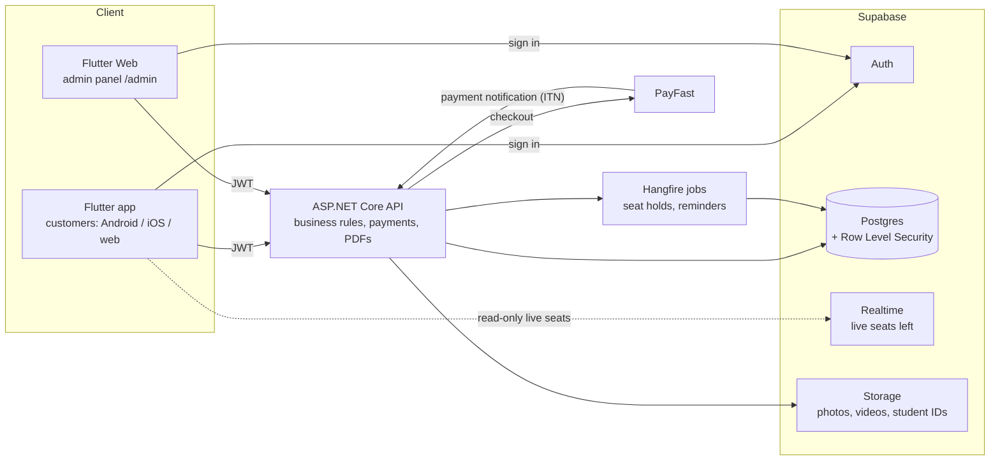

# Owen Tours and Travel

The booking app for **Owen Tours (Pty) Ltd** – *Explore the World*.

## The problem

Owen Tours sells trips through Instagram, Facebook, TikTok and WhatsApp posters ("Phone/WhatsApp 076 242 2251"). Customers send payment screenshots, seats get double-booked, nobody knows how many spots are left, and lay-by (instalment) payments are tracked by hand.

This app gives the company:

- **For customers (Android, iOS, web):** browse trips and see what's included (transport, meals, accommodation) and where each trip departs from. Book, pay in full or with a deposit plus monthly instalments, and track payments. Cancel within the policy and see the exact refund. Browse "Our Previous Trips" albums and send a "Plan a trip with us" enquiry.
- **For staff (web admin panel):** publish trips and departure dates with their own cancellation policies. Run specials (Youth Month, student and group discounts, promo codes) and check student IDs. Manage bookings and refunds, record EFT or cash payments, and download passenger lists (PDF/CSV). Upload previous trip albums, answer enquiries and manage admins.

## What's in this repo

```
/supabase     SQL migrations (schema, security rules, storage), seed data, database tests
/backend      ASP.NET Core 8 Web API (clean architecture) + tests
/app          Flutter app: customer app (mobile/web) and admin panel (web, /admin)
.github       CI: database tests, backend build + tests, Flutter analyze + tests
```

## Architecture



- **The app never writes to the database directly.** Every booking, payment and admin change goes through the API, which enforces the rules. Row Level Security is a second safety net: customers can only ever read their own bookings.
- **Money is always integer cents.** Prices are calculated on the server only.
- **Times are stored in UTC** and shown in South African time (UTC+2, no daylight saving).

## Key rules (and where they live)

| Rule | Where |
|---|---|
| No overbooking: an atomic `UPDATE … WHERE seats_booked + n <= capacity`, plus a database `CHECK` | `BookingService.CreateAsync`, schema |
| Seats held 20 minutes while paying; a job releases them every minute | `BookingService.ExpirePendingAsync`, `BookingJobs` |
| Deposit first, then equal monthly instalments; the rounding remainder goes on the last one | `InstalmentRules` |
| Cancellation policy set per departure: deadline as a date or "X days before", full / partial % / no refund, deposit refundable or not | `DepartureRules`, `CancellationRules` |
| A booking keeps the policy the customer agreed to, even if the admin changes it later | `PolicySnapshot` (saved on each booking) |
| Payments are applied only from a verified PayFast notification (signature, source IP, amount, server check). Repeat notifications do nothing | `PayFastGateway`, `PaymentService` |
| A payment that arrives after the seat hold expired gets the seats back if any are free, or is flagged for refund | `PaymentService.ApplyAsync` |
| Cross-border trips (Lesotho, Mozambique): passport and expiry required; blocked if it expires before the trip ends; warning within 6 months | `TravellerRules` |
| Youth camps: booked by a guardian with consent, grade range, medical and allergy details | `TravellerRules` |
| One discount per booking, whichever saves the most. Student discount waits for staff approval. Promo codes respect max uses | `Pricing.ChooseDiscount`, `BookingService.ReviewDiscountAsync` |
| Every admin action and payment change is written to the audit log | `AuditLogger` |
| Reminders (instalment due in 3 days, overdue, departure tomorrow, passport check 30 days before) never send twice | `ReminderService`, `notifications.dedupe_key` |

## Setup

### 1. Supabase

1. Create a project at [supabase.com](https://supabase.com). Choose the Cape Town region if it's offered.
2. Run the SQL in this order, either in the **SQL Editor** or with the Supabase CLI (`supabase link` then `supabase db push`):
   1. `supabase/migrations/20261110000001_schema.sql`
   2. `supabase/migrations/20261110000002_functions.sql`
   3. `supabase/migrations/20261110000003_rls.sql`
   4. `supabase/migrations/20261110000004_storage.sql`
   5. `supabase/seed.sql` (demo trips based on Owen Tours' Instagram)
3. **Authentication → Providers:** keep Email on. **Authentication → URL configuration:** set the Site URL to your web app's address.
4. Copy from **Project Settings → API**: the project URL, the `anon` key (goes in the app) and the `service_role` key (goes in the API only, never in the app).

### 2. API (`/backend`)

```bash
cd backend
dotnet user-secrets --project src/OwenTours.Api set "ConnectionStrings:Database" "Host=...;Port=5432;Database=postgres;Username=...;Password=...;SSL Mode=Require;Trust Server Certificate=true"
dotnet user-secrets --project src/OwenTours.Api set "Supabase:Url" "https://YOUR_REF.supabase.co"
dotnet user-secrets --project src/OwenTours.Api set "Supabase:ServiceRoleKey" "YOUR_SERVICE_ROLE_KEY"
dotnet run --project src/OwenTours.Api          # http://localhost:5080/swagger
dotnet test tests/OwenTours.Domain.Tests
```

See `backend/.env.example` for every setting.

- **Connection:** use the Supabase **Session pooler** or **Direct** connection (port 5432).
- **PayFast notifications on localhost:** PayFast must be able to reach your API. Run a tunnel such as `cloudflared tunnel --url http://localhost:5080` and set `PayFast:NotifyUrl` to `<tunnel>/api/payments/payfast/notify`. While testing locally you can set `PayFast:ValidateSourceIp=false`. When hosted behind a proxy, set `ForwardedHeaders:Enabled=true` instead.
- **Email:** without SMTP settings, messages go to the log and the `notifications` table.
- **Docker:** `docker build -t owen-tours-api backend && docker run -p 8080:8080 --env-file backend/.env owen-tours-api`

### 3. App (`/app`)

```bash
cd app
flutter create . --project-name owen_tours --platforms android,ios,web   # adds the platform folders; keeps lib/
flutter pub get
flutter run --dart-define=SUPABASE_URL=https://YOUR_REF.supabase.co \
            --dart-define=SUPABASE_ANON_KEY=YOUR_ANON_KEY \
            --dart-define=API_BASE_URL=http://10.0.2.2:5080        # Android emulator → your PC
flutter run -d chrome --web-port 5000 --dart-define=...            # admin panel: open /admin
flutter test
```

After `flutter create`, make these platform changes:

- **Android** `android/app/src/main/AndroidManifest.xml`: add `<uses-permission android:name="android.permission.INTERNET"/>` above `<application>` (release builds need it). If you test against a local `http://` API, also add `android:usesCleartextTraffic="true"` to `<application>`.
- **iOS** `ios/Runner/Info.plist`: add `NSPhotoLibraryUsageDescription` ("To upload your student ID and trip photos") and `NSCameraUsageDescription`.
- **Web:** add the web app's address (e.g. `http://localhost:5000`) to `Cors:AllowedOrigins` in the API settings.

### Test accounts

In Supabase **Authentication → Users → Add user**, create:

| Email | Use |
|---|---|
| `admin@owentours.test` | Staff/admin |
| `customer@owentours.test` | Normal customer |
| `guardian@owentours.test` | Parent booking the Youth Adventure Camp |

Then make the first one an admin (SQL Editor):

```sql
update public.profiles set role = 'admin'
where id = (select id from auth.users where email = 'admin@owentours.test');
```

After that, admins invite other admins from **Admin → Company & staff**. Nobody can sign up as an admin.

**PayFast sandbox:** the API ships with PayFast's public sandbox merchant (`10000100`). Use the sandbox's test payment options on the checkout page.

## Tests

- **Database** (`supabase/tests`, runs on a plain Postgres in CI):
  - security rules: guests, customers and admins each see only what they should
  - constraints: no overbooking, valid policies, booking totals, unique promo codes
  - a race test where 40 people try to book a 14-seat departure at the same moment, and exactly 14 succeed
- **Backend** (`backend/tests/OwenTours.Domain.Tests`, 90 tests):
  - prices and discounts, deposits and instalment schedules (including rounding)
  - cancellation before, exactly at and after the deadline; full, partial and no refunds; deposit refundable or not
  - the saved policy surviving admin changes
  - passport, youth camp and adults-only rules; SA ID numbers
  - payment states, repeated payment notifications and PayFast signatures
- **App** (`app/test`): money and date formatting, the "What's included" section, and the booking form (policy checkbox required, passport fields on cross-border trips).

## Technical challenges (for the portfolio write-up)

1. **Two people, one last seat.** The seat count changes in a single conditional `UPDATE`, inside the same transaction as the booking. If no row changes, the trip is full and the booking is refused. A `CHECK (seats_booked <= capacity)` constraint backs this up, and the database tests prove it with 40 parallel sessions.
2. **Seat holds.** A new booking is `pending` and holds its seats for 20 minutes. A Hangfire job releases expired holds with another conditional update, so it can never expire a booking that was paid a second earlier. Late payments are handled too: the seats come back if still free, otherwise the payment is flagged for refund.
3. **Webhooks you can trust.** PayFast notifications are verified four ways (signature, source IP, amount, server check). Only the first notification can move a payment to `complete`, so repeats are harmless.
4. **Instalments (lay-by).** A deposit, then equal monthly parts ending on the final due date, with the rounding remainder on the last part. When a student discount is approved later, only the unpaid instalments are re-spread, and paid money never changes.
5. **Policies that don't move under people's feet.** Each booking stores a copy of the cancellation policy it accepted. Refunds are always worked out on the server and shown before the customer confirms.
6. **Privacy (POPIA).** ID and passport numbers are masked for customers. Student ID photos sit in a private bucket and are reached through 15-minute links. Re-encoding photos strips GPS data. Passenger lists are marked confidential.

## What still needs the client (Owen Tours)

- **Prices and places:** the real Mozambique, Cape Town and hiking prices, the departure towns and meeting places (the seed data uses placeholders), and the office address.
- **Branding:** the original logo and photos. Instagram copies are low quality.
- **Child pricing:** the age that counts as a child. The app currently uses under 18.
- **Refunds:** how they're paid out. The app tracks them, and staff mark them as paid after an EFT.
- **Children crossing the border:** which documents families must bring. The app reminds them generically.
- **Payments:** a real PayFast merchant account for going live.
- **Testimonials:** the seeded sample testimonials are hidden. Publish only real customer words, with permission.

## Licences to check before launch

- **QuestPDF** (PDFs): Community licence, free under USD 1M annual revenue.
- **SixLabors ImageSharp** (image resizing): Split licence, free for small companies. Check the current terms.
